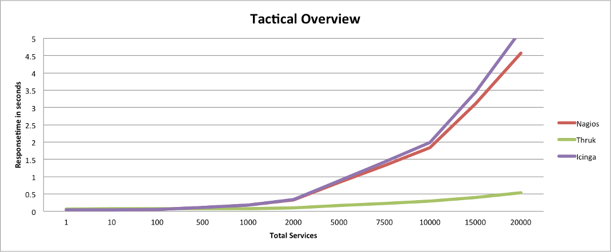
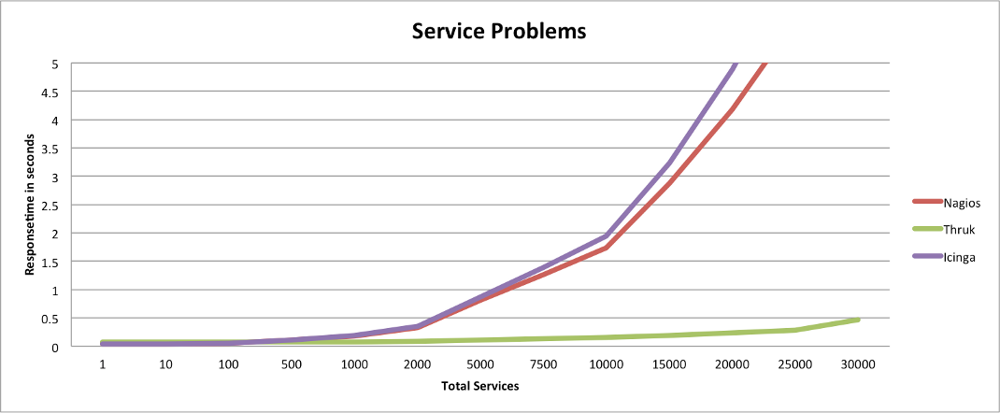
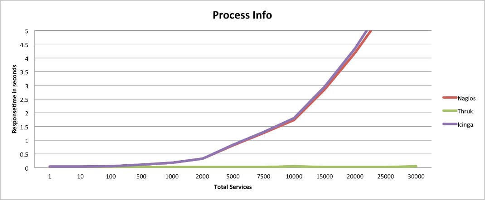
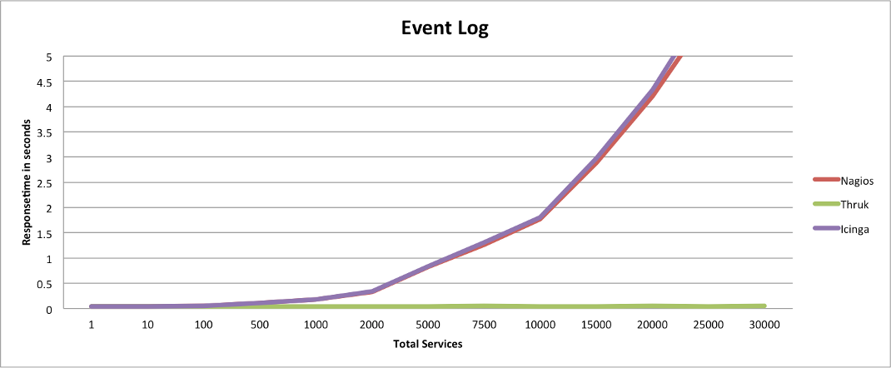

# Benchmarking Thruk

I often get asked if there are any benchmarks for Thruk so i finally
decided to do some tests.

## Test Setup

Since [OMD](http://omdistro.org) made it so easy and fast to setup a test environment i would
be a fool to not use it for tests too.

In order to create test hosts and services i used the
[Monitoring::Generator::TestConfig](http://search.cpan.org/dist/Monitoring-Generator-TestConfig/)
Perl module and wrapped a simple perl script around ([gui_benchmark.pl on GitHub](https://github.com/sni/omd_utils/blob/master/benchmark/gui/gui_benchmark.pl)).

Used Versions:

* Thruk 1.1.1
* Nagios 3.2.3
* Icinga 1.5.1

The tested hardware is a quad core i5 with 8gb memory installed.

Test:

1. create test services
2. submit some passive check results
3. wait till the checks are processed by the core
4. stop the core so it does not waste cpu cycles
5. run Apache Bench (ab) 5 times for each gui and take the fastest result

The rests itself consists of 100 requests with 5 concurrent requests.

## Result

The following charts draw the response time for some common pages.
Lower response times means faster pages.

The response time contains only the response of the main page content.
Your browser will propably take longer because it has to fetch images
and css stylesheets and render the hole page.

## Conclusion

The images speak for themselves, parsing the status.dat for every
request takes time and increases linear with the amount of services.
Requesting only the needed data for the specific page via livestatus
has a much lower overhead and is therefor much faster, but still
increases linear with the amount of services of course. Just at a much
lower rate.

The biggest performance issues for the status.dat based CGIs is on
pages where no or nearly no data is needed, like the process info page
or the commands page. The repsonse time for Thruk stays nearly
constant where Nagios or Icinga still need to parse the hole
status.dat.

Main factor for Thruks response time is the amount of data returned
for each query. The more data on a page, the longer it takes. That's
one reason why Thruk usually uses paging on larger pages.
