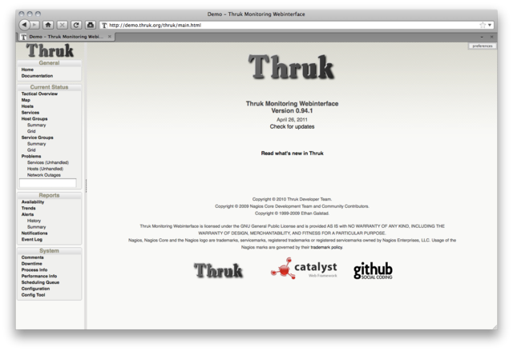
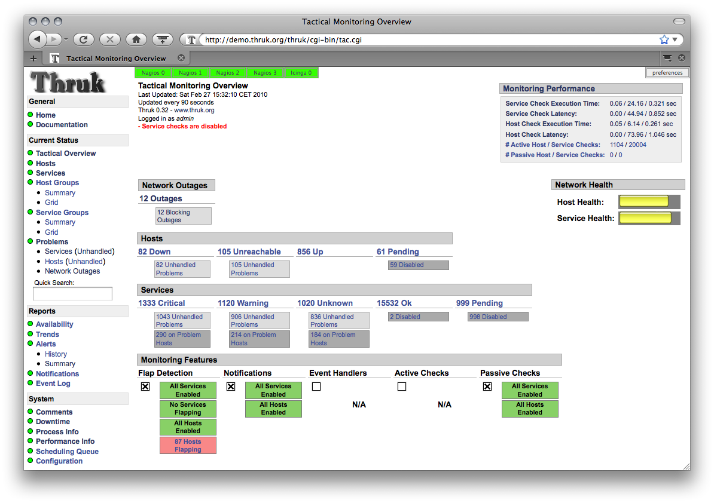
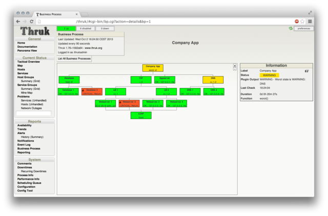
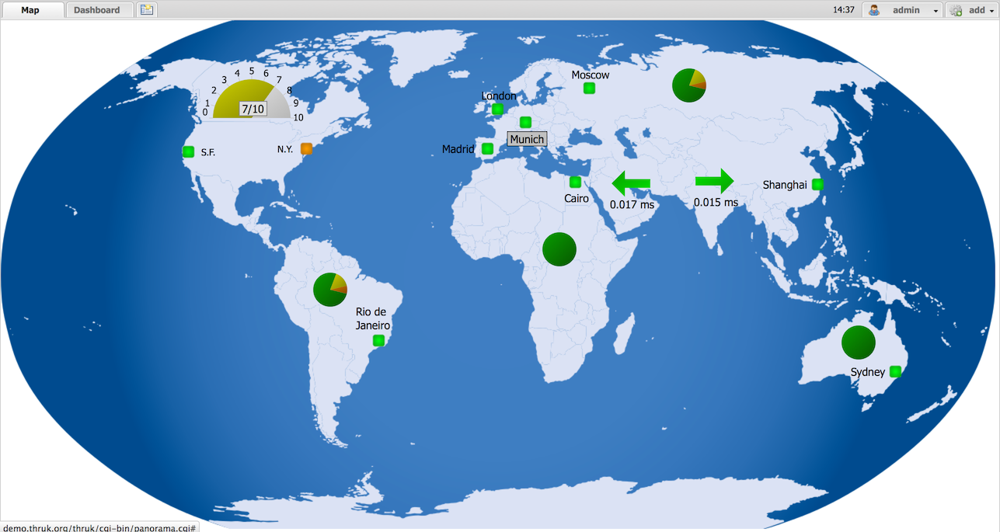
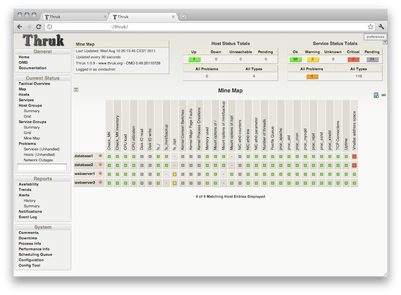
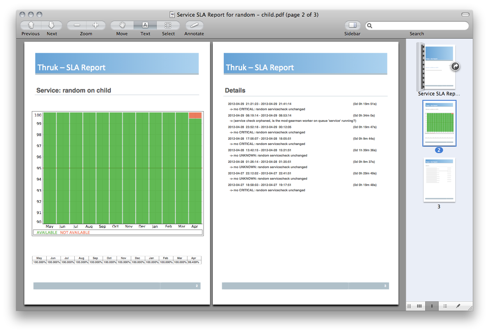

## Release plan

| [Stable](/download.html) | [Nightly](/download.html#nightly-development-builds) | [Next](https://github.com/sni/Thruk/blob/master/Changes) |
| --- | --- | --- |
| {{VITE_RELEASE_DATE}} | Every day | {{VITE_NEXT_RELEASE_DATE}} |

## Introduction

Thruk is a monitoring web interface for multiple backends.
It supports Naemon, Nagios, Icinga and Shinken through the Livestatus API.
It is designed as a drop-in replacement for the classic interface and covers almost 100% of its features.
It adds features for large installations and usability improvements.

[Learn more](/documentation/introduction.html)

## Screenshots

<figure><figcaption>Main page</figcaption></figure>
<figure><figcaption>Dark theme</figcaption></figure>
<figure><figcaption>Business Process</figcaption></figure>
<figure><figcaption>Panorama dashboard</figcaption></figure>
<figure><figcaption>Mine map</figcaption></figure>
<figure><figcaption>SLA reports</figcaption></figure>

[More screenshots](/screenshots.html)
