# Screenshots

[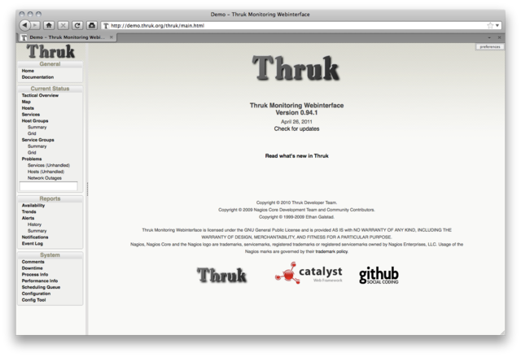](/images/galleries/01_main.png)
[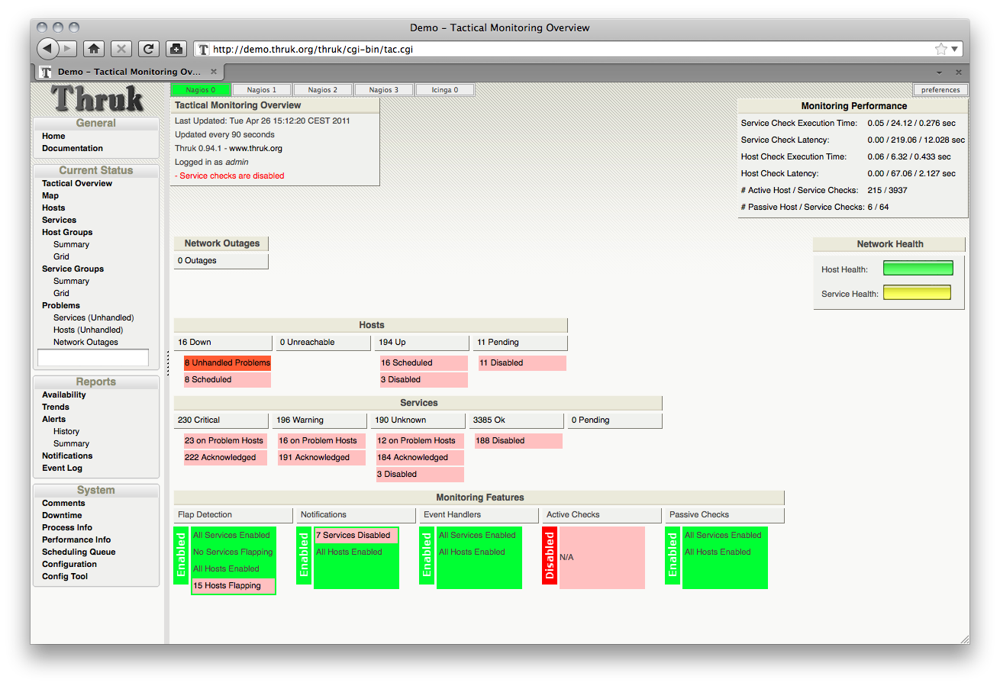](/images/galleries/02_tac.png)
[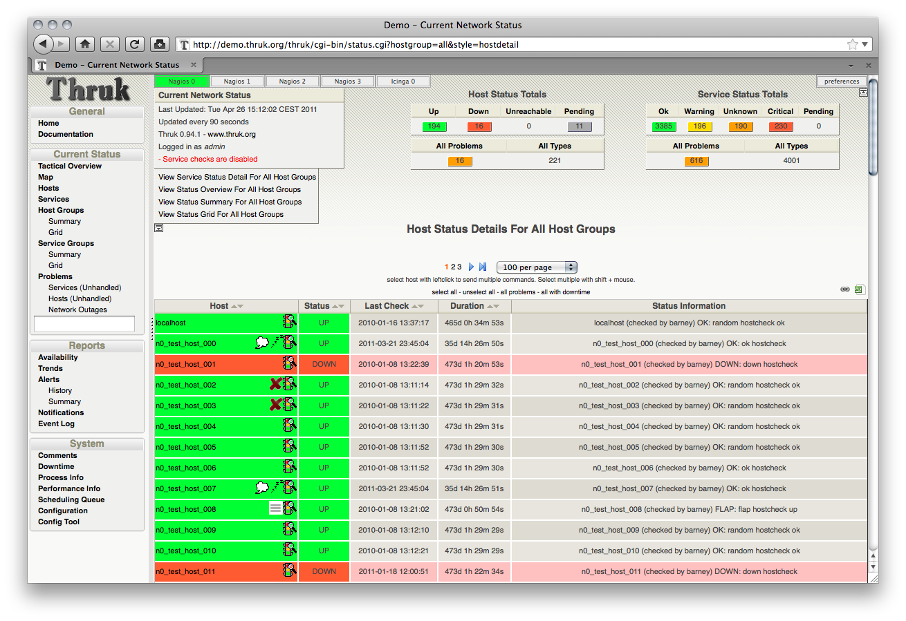](/images/galleries/03_hosts.png)
[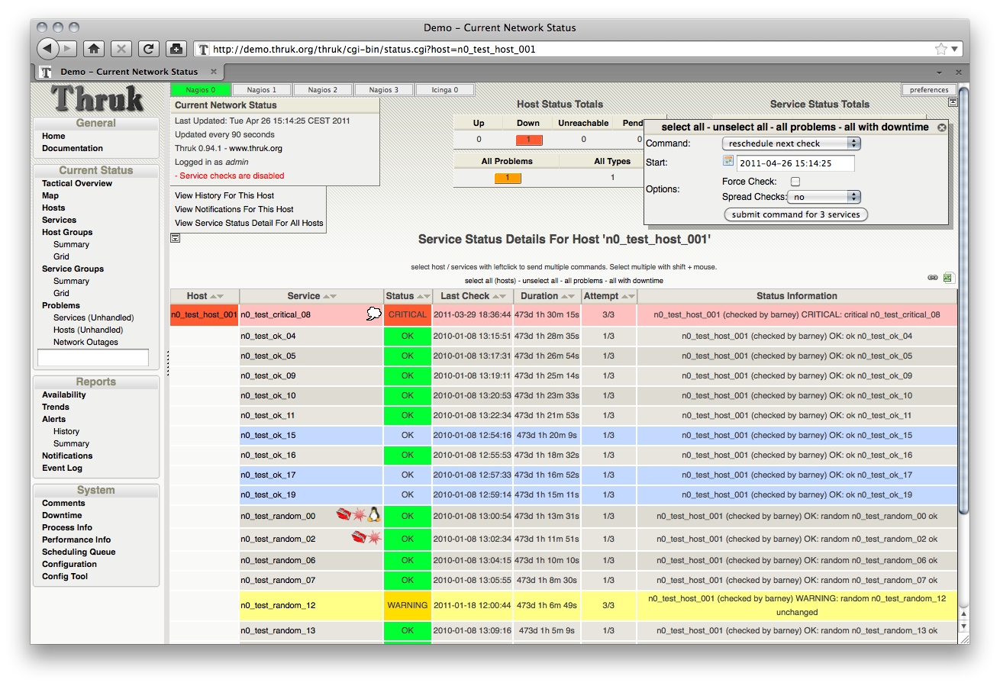](/images/galleries/04_multi_commands_from_status_page.png)
[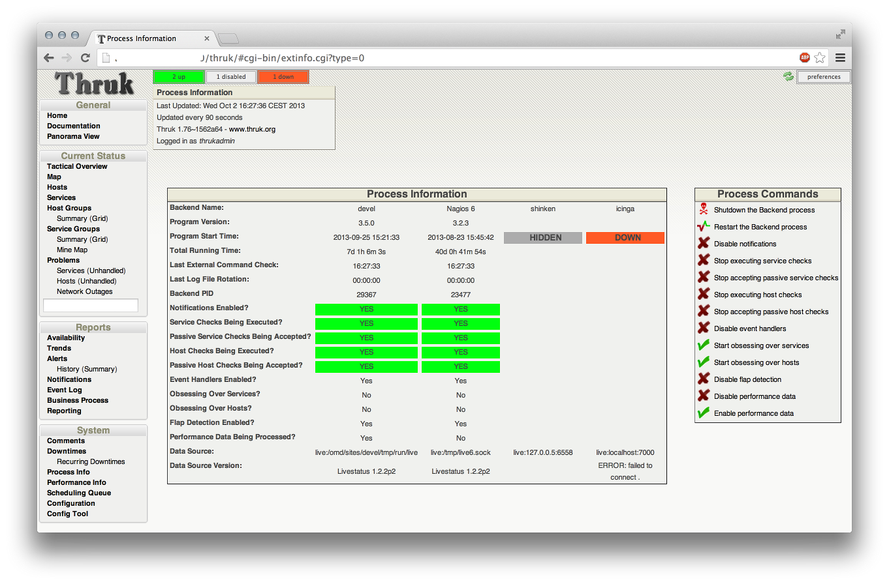](/images/galleries/05_extinfo_0.png)
[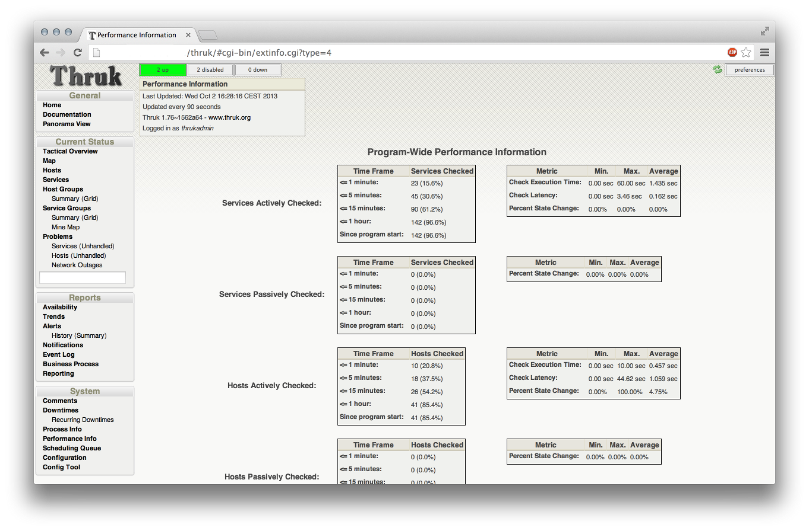](/images/galleries/06_extinfo_4.png)
[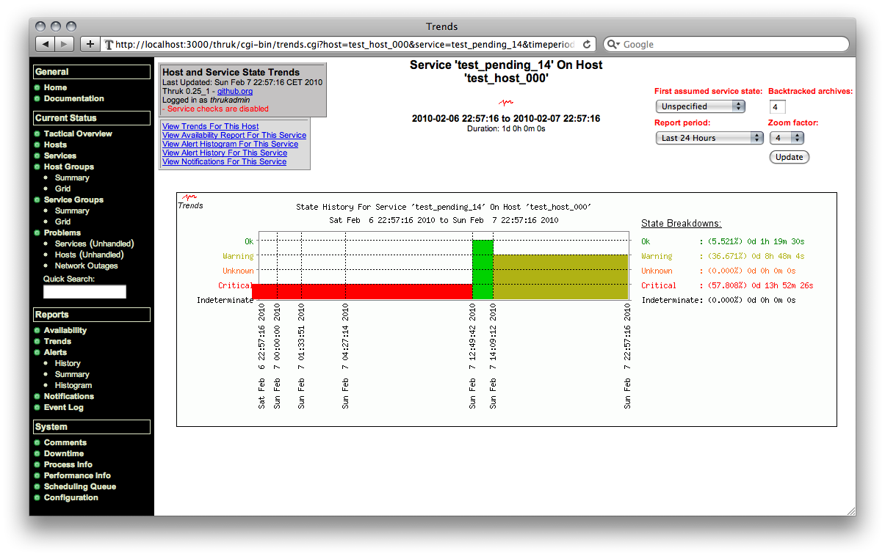](/images/galleries/07_trends.png)
[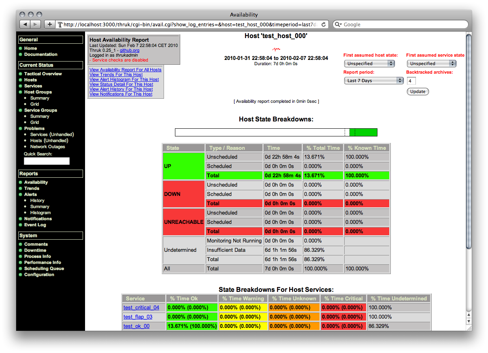](/images/galleries/08_avail.png)
[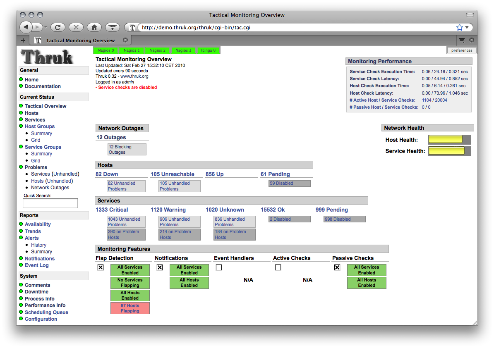](/images/galleries/09_theme_1.png)
[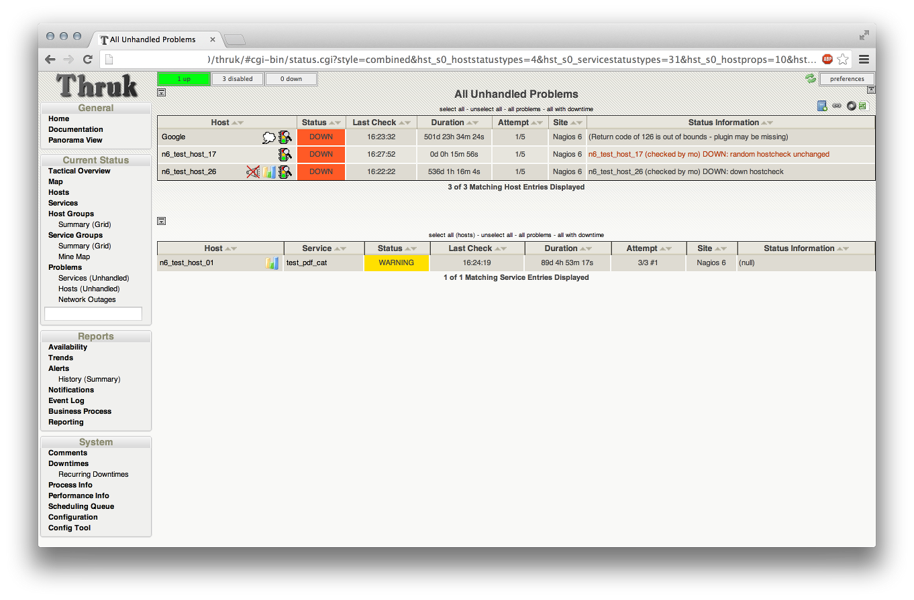](/images/galleries/15_problems_view.png)
[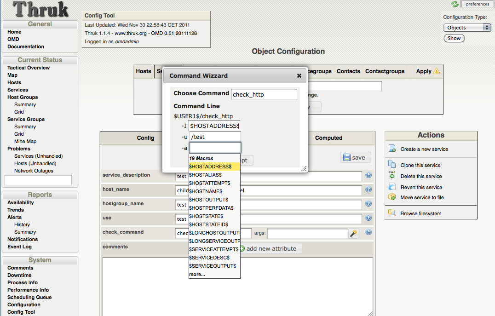](/images/galleries/16_config_tool.png)
[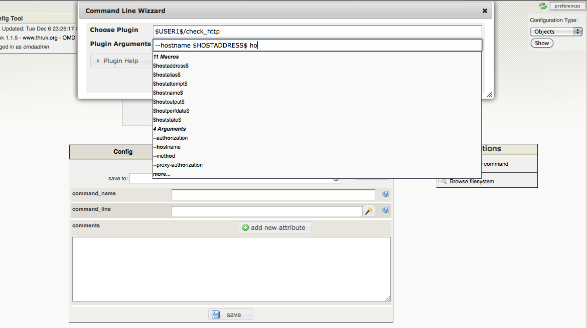](/images/galleries/17_config_tool2.png)
[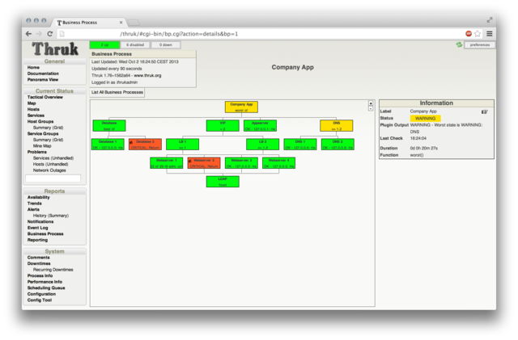](/images/galleries/18_business_process.png)
[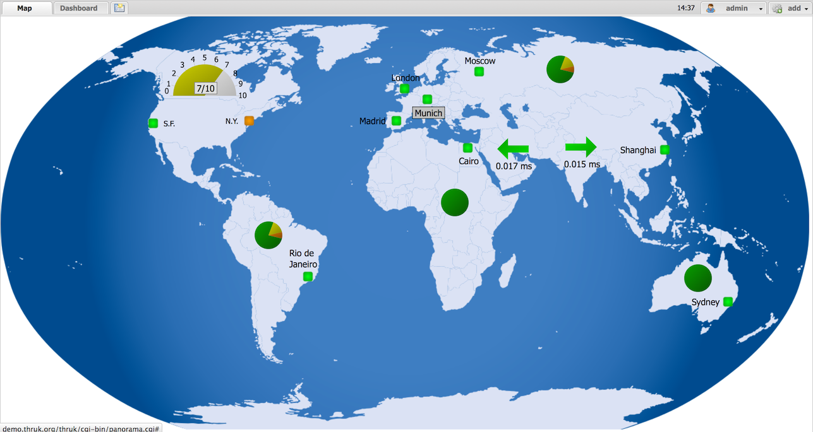](/images/galleries/dashboard.png)
[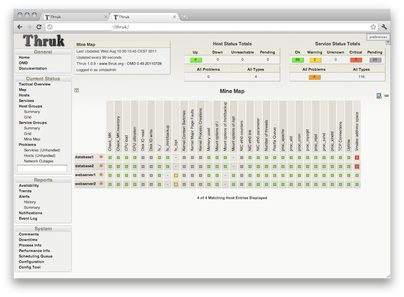](/images/galleries/mine-map1.png)
[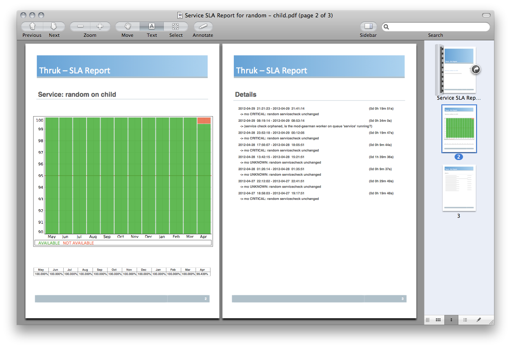](/images/galleries/reports3.png)

